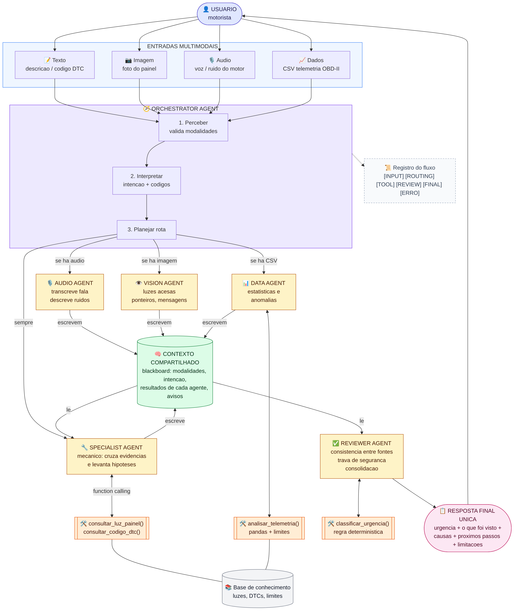

# 🚗 AutoAssist IA — Sistema Multimodal com Agentes de IA (Checkpoint 6)

Assistente automotivo que recebe **texto + foto do painel + áudio + telemetria OBD-II (CSV)**, decide quais
agentes especialistas acionar, usa ferramentas e entrega **uma única resposta consolidada** com nível de urgência,
causas prováveis e próximos passos.



## Requisitos do Checkpoint → onde estão no código

| Requisito | Implementação |
|---|---|
| Entrada multimodal | texto, imagem, áudio e dados CSV (`agentes/orquestrador.py → perceber`) |
| Agente orquestrador | `agentes/orquestrador.py` — percebe, interpreta intenção, planeja rota, coordena |
| ≥ 2 agentes especializados | Vision (`visao.py`), Audio (`audio.py`), Data (`telemetria.py`), Specialist/Mecânico (`mecanico.py`), Reviewer (`revisor.py`) |
| Compartilhamento de contexto | `nucleo/contexto.py` — objeto `Contexto` (blackboard) lido/escrito por todos |
| Ferramenta / função | `analisar_telemetria`, `consultar_luz_painel`, `consultar_codigo_dtc` (via *function calling*), `classificar_urgencia` |
| Resposta consolidada | `agentes/revisor.py` |
| Registro do fluxo | `RegistroFluxo` — linhas `[INPUT] [ORCHESTRATOR] [ROUTING] [TOOL] [REVIEW] [FINAL] [ERRO]` |
| Tratamento de erro | imagem corrompida, imagem que não é painel, CSV inválido, áudio vazio, falha/ausência da API (modo offline), pedido fora do escopo, nenhuma entrada |

## Como executar

```bash
python -m venv .venv && source .venv/bin/activate   # Windows: .venv\Scripts\activate
pip install -r requirements.txt
python gerar_exemplos.py                             # (re)gera imagens e CSVs de exemplo

# chave gratuita em https://aistudio.google.com/apikey
export GEMINI_API_KEY="sua_chave"                    # Windows PowerShell: $env:GEMINI_API_KEY="sua_chave"

streamlit run app.py                                 # interface web
```

Na interface: escolha um cenário na barra lateral → **Carregar cenário** → **Analisar**. Ou envie seus próprios
arquivos (fotos reais de painel funcionam melhor que as imagens sintéticas).

Pelo terminal:

```bash
python executar_cli.py --cenario 1
python executar_cli.py --texto "O carro esta tremendo, codigo P0301" --csv exemplos/telemetria_falha_ignicao.csv
python executar_cli.py --cenario 2 --offline         # força o modo sem IA (fallback por regras)
```

**Sem chave de API** o sistema roda em **modo offline**: Vision e Audio ficam indisponíveis (e isso aparece no log e
nas limitações da resposta), e os demais agentes usam regras + ferramentas locais.

## Cenários prontos (`cenarios.py`)

1. **Superaquecimento** — foto com luz de temperatura + CSV com temperatura subindo → urgência CRÍTICA, confirmação por duas fontes.
2. **Falha de ignição** — texto com código P0300 + CSV com RPM oscilando + luz de injeção → ATENÇÃO.
3. **Bateria/alternador** — luz da bateria + tensão caindo.
4. **Tratamento de erro** — imagem corrompida + CSV com colunas erradas → descarta, avisa e responde INCONCLUSIVO.
5. **Divergência** — luz de temperatura na foto, mas telemetria normal → Reviewer aponta a divergência.
6. **Fora do escopo** — pergunta não automotiva → orquestrador não aciona especialistas.

## Formato do CSV de telemetria

Colunas reconhecidas (mínimo 2 métricas e 5 linhas): `tempo_s, velocidade_kmh, rpm, temp_motor_c, tensao_bateria_v, pressao_oleo_bar`.

## Estrutura

```
app.py               interface Streamlit
executar_cli.py      execução pelo terminal
cenarios.py          cenários de demonstração
gerar_exemplos.py    gera imagens/CSVs de exemplo
agentes/             orquestrador + agentes especializados
ferramentas/         funções externas ao LLM (base de conhecimento, telemetria, urgência)
nucleo/              contexto compartilhado, registro do fluxo, cliente Gemini
dados/               base de conhecimento (JSON)
exemplos/            arquivos de entrada de exemplo
docs/                diagrama da arquitetura
```

> Protótipo acadêmico. Não substitui a avaliação de um mecânico.
